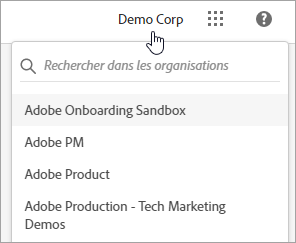
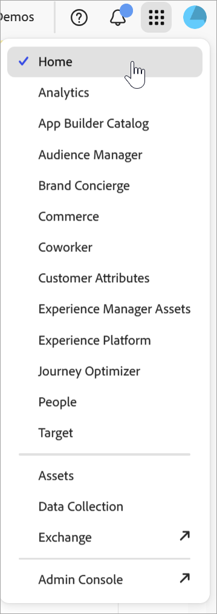
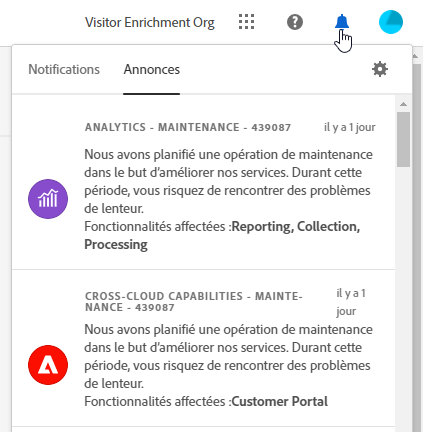
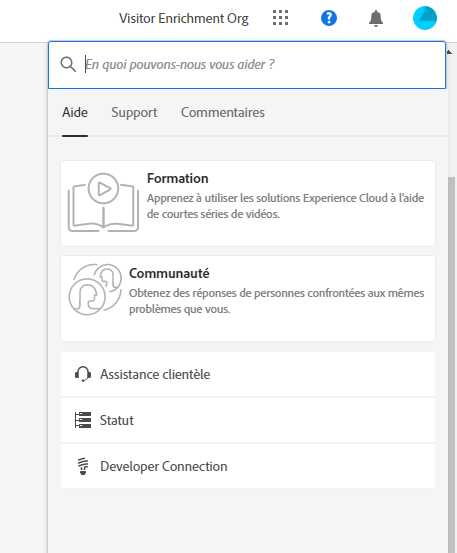

# Prise en main de CX Enterprise {#get-started}

Connectez-vous à [Adobe CX Enterprise](https://experience.adobe.com?lang=fr) pour lancer vos applications, puis utilisez l’en-tête unifié pour gérer votre profil, vérifier les notifications et trouver de l’aide, le tout à un seul endroit.

## Avant de commencer {#before-you-begin}

Vous avez besoin d’une Adobe ID qui a été configurée pour les produits CX Enterprise de votre organisation. Si vous ne parvenez pas à vous connecter ou ne voyez pas les applications attendues, contactez votre [!UICONTROL administrateur de CX Enterprise] [administrateur](administration/admin-console.md).

## Connexion à CX Enterprise {#sign-in}

Connectez-vous et vérifiez que vous vous trouvez dans la bonne [organisation](administration/organizations.md).

1. Accédez à [Adobe CX Enterprise](https://experience.adobe.com?lang=fr).
1. Saisissez votre adresse e-mail Adobe, puis cliquez sur **[!UICONTROL Continuer]**.
1. Cliquez sur un compte.
1. Saisissez votre mot de passe.
1. Assurez-vous que vous êtes dans la bonne organisation.

   

   **Vérification de votre organisation**

   L’ [organisation](administration/organizations.md) s’affiche dans l’en-tête de l’interface.

   Si votre entreprise utilise des Federated ID, CX Enterprise vous permet de vous connecter à l’aide de l’authentification unique de votre entreprise sans avoir à saisir votre adresse e-mail et votre mot de passe. Ajoutez `#/sso:@domain` à l’URL CX Enterprise (`https://experience.adobe.com`) pour accomplir cette tâche.

   Par exemple, pour une organisation avec des Federated ID et le domaine `example.com`, définissez votre lien URL sur `https://experience.adobe.com/#/sso:@example.com`. Vous pouvez également accéder directement à une application spécifique en marquant cette URL avec le chemin de l’application. (Par exemple, pour Adobe Analytics, `https://experience.adobe.com/#/sso:@example.com/analytics`.)

   **Remarque :** l’administrateur de votre organisation peut restreindre l’accès aux produits Adobe par adresses IP. Si tel est le cas, vous pouvez recevoir une erreur après vous être connecté à CX Enterprise ou avoir basculé vers une organisation avec cette option activée. Pour plus d&#39;informations, consultez la section [Limiter l&#39;accès au produit par adresses IP](https://helpx.adobe.com/fr/enterprise/using/ip-based-access.html).

## Accès aux applications CX Enterprise {#applications}

Une fois connecté à CX Enterprise, vous pouvez accéder rapidement à l’ensemble de vos applications, services et organisations à partir de l’en-tête unifié.

Pour accéder aux applications et services CX Enterprise configurés pour vous au sein de votre organisation, accédez au menu .

## Gérer votre profil utilisateur {#profile}

Dans le menu [!UICONTROL Profil], vous pouvez :

* Spécifier un thème sombre (toutes les applications ne prennent pas en charge ce thème).
* Gérer Les [Préférences](features/account-preferences.md) De CX Enterprise
* Sélectionner ou rechercher une [organisation](administration/organizations.md)
* Afficher [!UICONTROL Mentions Légales]
* Se déconnecter
* Configurer les préférences du compte, les notifications et les abonnements

## Afficher des notifications et des annonces dans le produit {#notifications}

Cliquez sur l’icône représentant une cloche pour afficher les notifications et les annonces. Les annonces peuvent être pertinentes et exploitables. Cela inclut notamment les mises à jour de produits, les avis de maintenance, les éléments partagés et les demandes d’approbation.

Pour gérer les notifications et les alertes, consultez [Préférences et notifications du compte](features/account-preferences.md).

## Obtenir de l’aide et une assistance {#help}

Accédez à l’apprentissage et à l’aide à l’aide du **[!UICONTROL centre d’aide]** () dans l’en-tête, y compris le contenu de l’aide (documentation, tutoriels et cours) sur [Experience League](https://experienceleague.adobe.com/fr?lang=fr#home), ainsi que des ressources supplémentaires pour des applications individuelles. Vous pouvez également envoyer des commentaires ouverts et créer des tickets dʼassistance prioritaires.

Le menu [!UICONTROL Aide] vous donne également accès aux éléments suivants :

* **[!UICONTROL Assistance] :** créez un ticket d’assistance ou contactez l’[!UICONTROL assistance] à l’aide de Twitter.
* **[!UICONTROL Commentaires] :** partagez vos commentaires au sujet de votre expérience CX Enterprise. Vos commentaires sont utilisés pour améliorer les produits et services d’Adobe.
* **[!UICONTROL Statut] :** Accédez à `https://status.adobe.com/fr-fr/experience_cloud` et vérifiez le statut opérationnel du produit et [!UICONTROL Gérez les abonnements].
* **[!UICONTROL Developer Connection]:** Navigation vers `adobe.io` et recherche de la documentation destinée aux développeurs.

## Plus d’aide sur cette rubrique {#more-help}

* [Gestion des utilisateurs et des produits dans Admin Console](administration/admin-console.md)
* [Prise en main du service Personnes](services/getting-started.md)
* [Préférences et notifications du compte](features/account-preferences.md)
